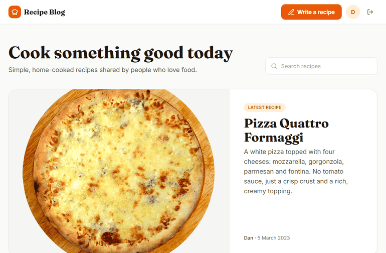
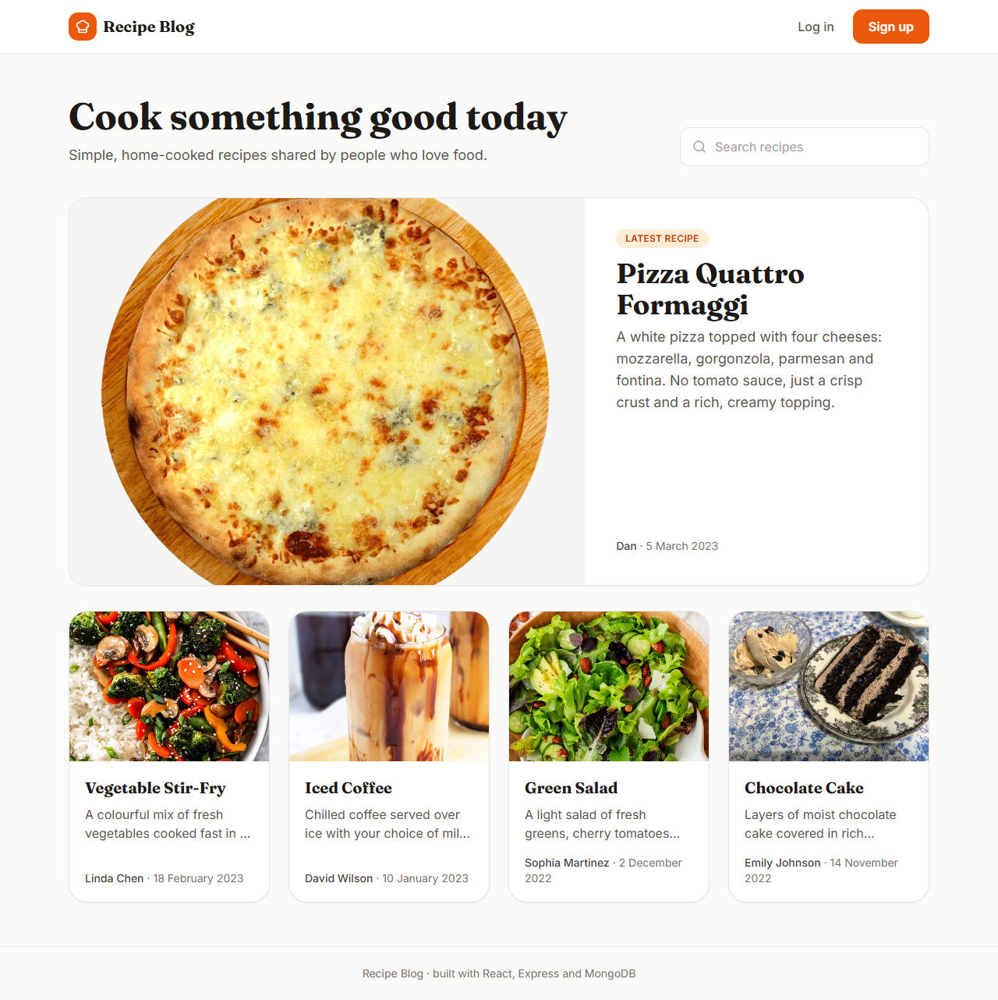
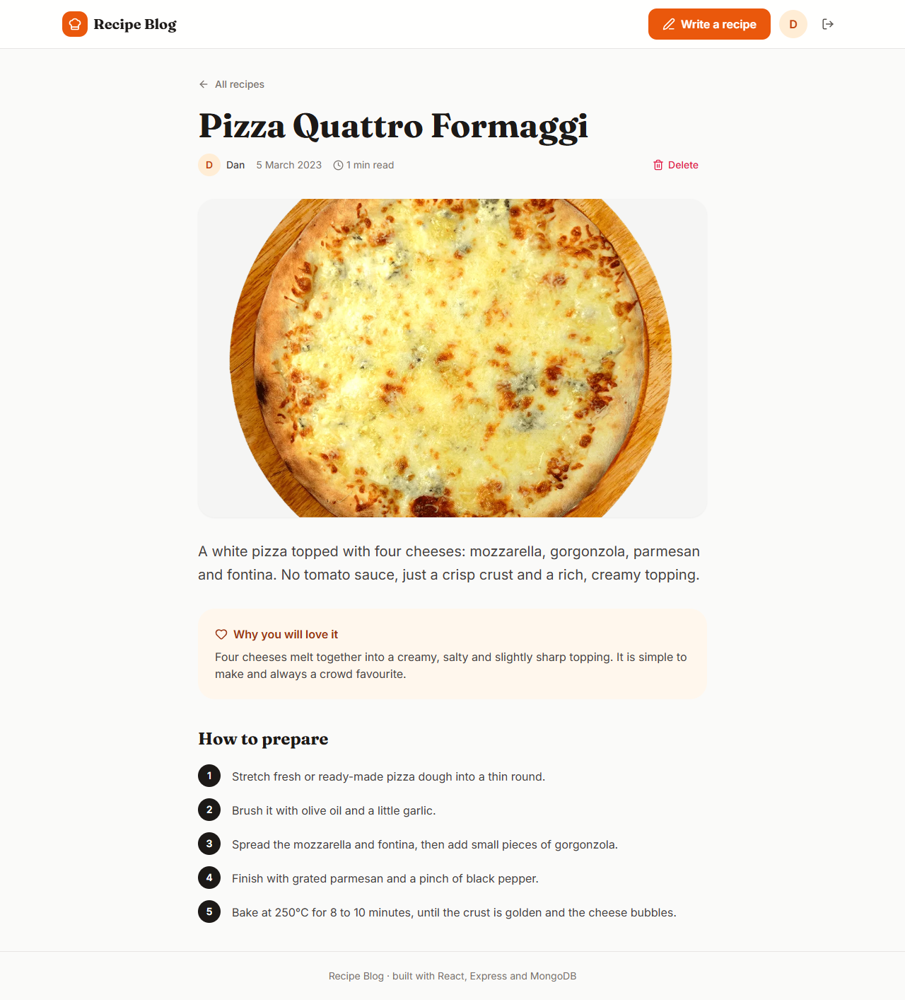
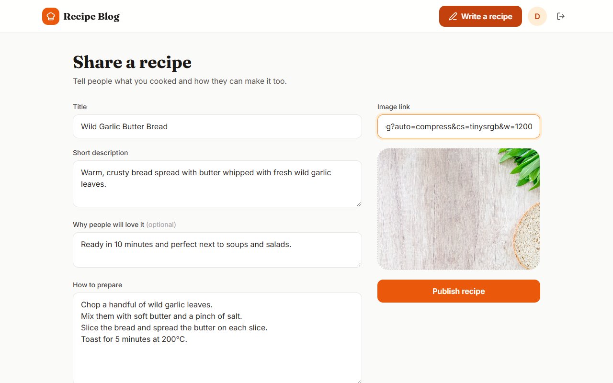
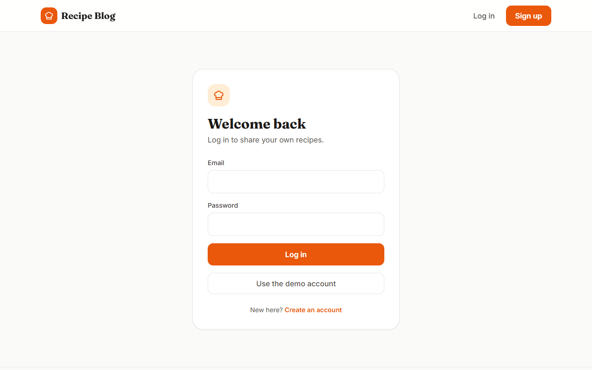
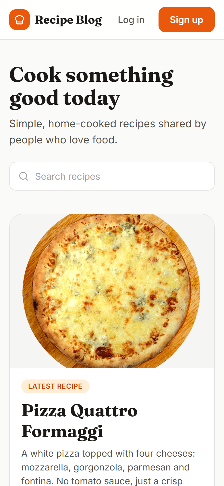
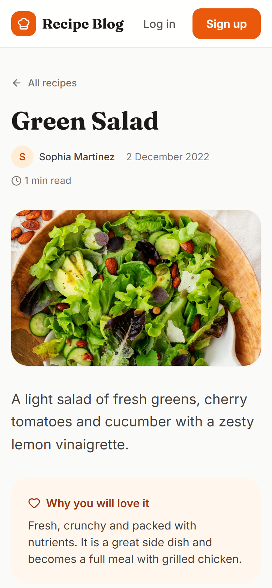

# Recipe Blog: MERN app for sharing recipes

A full-stack blog where people share home-cooked recipes. Anyone can browse and search the recipes; after signing up you can publish your own and delete the ones you wrote.



*Logged in as the demo user: writing a recipe with a live image preview, publishing it, then deleting it.*



| Recipe page | Writing a recipe |
|---|---|
|  |  |

| Log in | Phone: list | Phone: recipe |
|---|---|---|
|  |  |  |

## Features

- **Browse and search** recipes by title, newest first, with the latest one featured at the top.
- **Recipe page** with author, date, reading time, a "why you will love it" section and numbered preparation steps.
- **Sign up and log in** with JWT authentication. Passwords are hashed with bcrypt and never sent back by the API.
- **Write a recipe** with a live preview of the image link. Only logged-in users can publish.
- **Delete your own recipes**: the server checks that you are the author, and the button asks for confirmation.
- **Responsive layout** that works on phones.
- **Demo data**: one command creates the demo accounts and recipes.

## Tech stack

| Layer | Technologies |
|---|---|
| Frontend | React 18, Vite, React Router, Tailwind CSS, Axios, Lucide icons |
| Backend | Node.js, Express, Mongoose |
| Database | MongoDB (Atlas or local) |
| Auth | JSON Web Tokens, bcrypt |
| Tests | Node test runner, Supertest, mongodb-memory-server |

## How it works

```
React (Vite, 5173)  ──  Axios + "Authorization: Bearer <token>"  ──►  Express API (3001)  ──►  MongoDB
```

1. Logging in returns a JWT. The frontend stores it with the user in `localStorage` and adds it to every request.
2. Protected routes (`POST /api/posts`, `DELETE /api/posts/:id`) go through an auth middleware that verifies the token.
3. Each post stores its author as a reference to a user, so the API can check ownership before deleting.

### API

| Method | Endpoint | Auth | Description |
|---|---|---|---|
| POST | `/api/auth/sign-up` | | Create an account, returns token and user |
| POST | `/api/auth/login` | | Email + password, returns token and user |
| GET | `/api/auth/me` | ✓ | The logged-in user |
| GET | `/api/posts?search=` | | All recipes, newest first |
| GET | `/api/posts/:id` | | One recipe |
| POST | `/api/posts` | ✓ | Publish a recipe |
| DELETE | `/api/posts/:id` | ✓ | Delete a recipe (author only) |

## Getting started

Requirements: Node.js 18+ and a MongoDB database (a free [MongoDB Atlas](https://www.mongodb.com/atlas) cluster works, or MongoDB installed locally).

**1. Backend**

```bash
cd server
npm install
copy .env.example .env      # macOS/Linux: cp .env.example .env
```

Put your connection string in `MONGODB_URI` and any long random text in `JWT_SECRET`, then:

```bash
npm run seed                # demo accounts and recipes
npm run dev                 # http://localhost:3001
```

**2. Frontend** (in a second terminal)

```bash
cd client
npm install
npm run dev                 # http://localhost:5173
```

Log in with **demo@blog.app** / **BlogDemo123!** or click "Use the demo account".

**Configuration**

| Variable | Where | Default | Used for |
|---|---|---|---|
| `MONGODB_URI` | server | (required) | MongoDB connection string |
| `JWT_SECRET` | server | (required) | Signs the login tokens |
| `PORT` | server | `3001` | API port |
| `CLIENT_URL` | server | any origin | Frontend address allowed by CORS |
| `VITE_API_URL` | client | `http://localhost:3001` | API address |

**Tests**

```bash
cd server
npm test
```

The 9 API tests run against an in-memory MongoDB, so they need no database setup. They cover sign-up, login, validation, search and the author-only delete rule.

## Project structure

```
client/src/
  pages/          Home, PostPage, NewPost, Login, SignUp, NotFound
  components/     Navbar, PostCard, AuthCard, RequireAuth
  lib/            API client, auth context, date and step formatting
server/
  index.js        connects to MongoDB and starts the server
  app.js          Express app and routes
  routes/         auth.js, posts.js
  models/         User, Post
  middleware/     JWT check
  seed/           demo recipes and seed script
  tests/          API tests
```

## What I would add next

- Editing recipes and uploading images instead of pasting links
- Comments and likes
- Categories and cooking time filters
- Pagination for long lists

The chocolate cake photo is from [Wikimedia Commons](https://commons.wikimedia.org/wiki/File:Chocolate_layer_cake_slice_with_ice_cream.jpg). The other recipe images are linked from the original food blogs.
